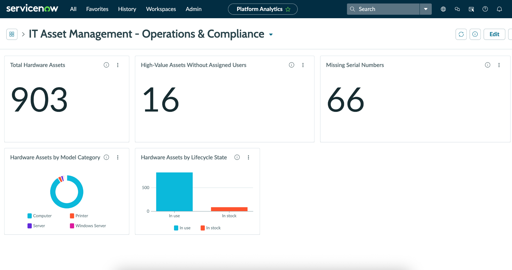
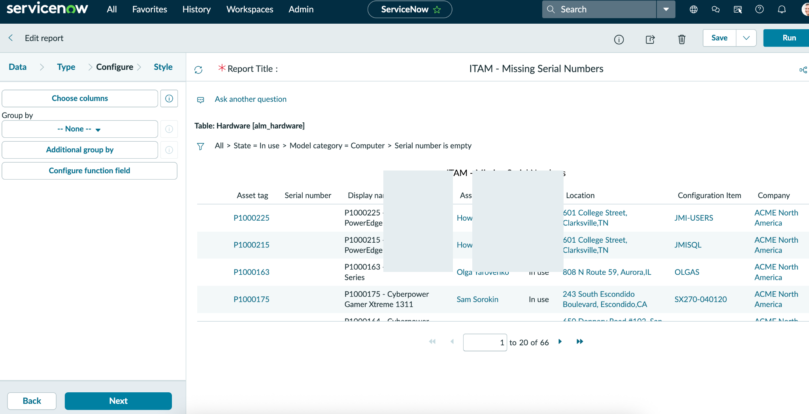
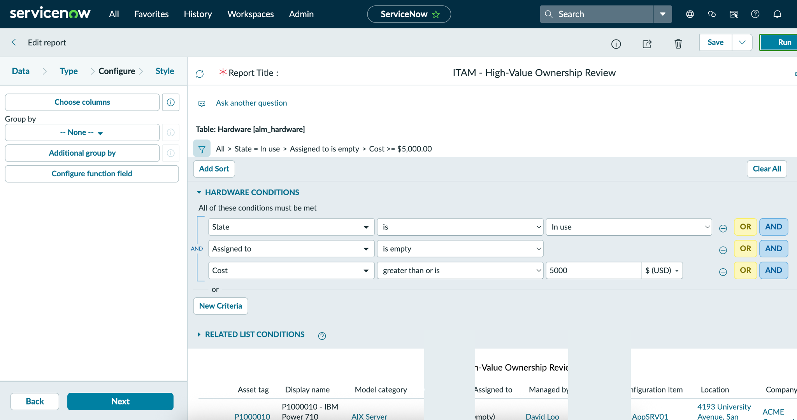
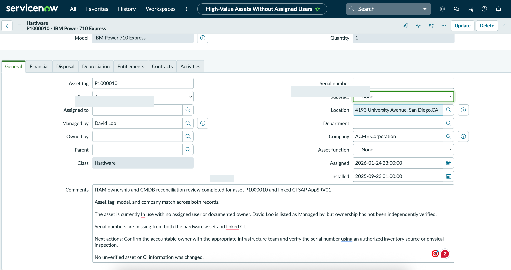
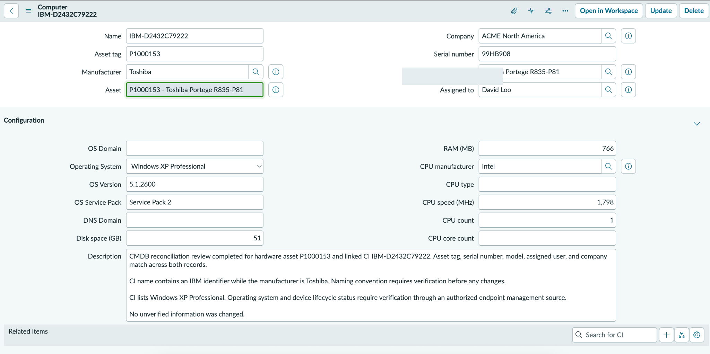

# ServiceNow IT Asset Management (ITAM) | Operations & Compliance Lab

Hands-on ServiceNow **Personal Developer Instance (PDI)** project demonstrating hardware asset lifecycle management, CMDB reconciliation, data-quality reporting, exception investigation, and operational dashboards.

> **Portfolio lab:** Work was performed in a personal learning environment with demonstration records, not an employer's production system. Metrics reflect the lab dataset at the time of review.

## Project Overview

This project follows a practical ITAM workflow: manage a hardware asset, review its linked configuration item (CI), identify incomplete records, investigate exceptions, document findings, and build a dashboard for operational visibility. The guiding principle is **verify before updating**: missing values should not be filled with guesses.

## Tools and Skills

- ServiceNow Hardware Asset Management (`alm_hardware`)
- IT asset lifecycle and assignment management
- Configuration Management Database (CMDB) reconciliation
- Data quality and exception reporting
- ServiceNow Platform Analytics dashboards
- Ownership verification, audit notes, and remediation planning

## Completed Lab Exercises

### 1. Hardware Asset Lifecycle

- Created a demonstration MacBook asset (`LAB-MBP-001`).
- Assigned the asset and transitioned it from **In stock** to **In use**.
- Reviewed the relationship between the hardware asset and its linked CI.

### 2. CMDB Data-Quality Investigation

- Examined asset `P1000225` and linked CI `JMI-USERS`.
- Identified missing serial-number information and an operating-system value requiring verification.
- Documented findings without introducing unverified values.

### 3. Exception Reports

Created two reports using the **Hardware [alm_hardware]** table:

| Report | Criteria | Matching lab records |
| --- | --- | ---: |
| ITAM - Missing Serial Numbers | State = In use; Model category = Computer; Serial number is empty | **66** |
| ITAM - High-Value Ownership Review | State = In use; Assigned to is empty; Cost ≥ USD 5,000 | **16** |

These reports produce *review queues*, not automatically confirmed violations. Some servers are appropriately managed by teams rather than assigned to individual users.

### 4. ITAM Operations & Compliance Dashboard

Built the **IT Asset Management - Operations & Compliance** dashboard with five widgets:

1. **Total Hardware Assets:** 903
2. **Hardware Assets by Lifecycle State:** bar chart
3. **Hardware Assets by Model Category:** doughnut chart
4. **Missing Serial Numbers:** 66
5. **High-Value Assets Without Assigned Users:** 16

Used dashboard drill-down to inspect the underlying 16-record high-value asset review list.

### 5. Asset-to-CI Reconciliation

Investigated **hardware asset `P1000010` (IBM Power 710 Express)** and linked CI **`SAP AppSRV01`**.

| Check | Observation |
| --- | --- |
| Cost | $5,852 |
| Lifecycle state | In use |
| Assigned to / Owned by | Empty on hardware asset |
| Managed by | Populated; not independently verified as accountable owner |
| Serial number | Missing on both asset and CI |
| Asset-to-CI comparison | Asset tag, model, and company matched |

**Recommended next action:** Confirm accountable ownership with the appropriate infrastructure team and verify the serial number through an authorized inventory source or physical inspection. Investigation notes were saved without changing unverified asset or CI fields.

## Visual Evidence

The screenshots below document work completed in a ServiceNow Personal Developer Instance using demonstration records. Counts represent the lab dataset at the time of review.

### 1. ITAM Operations & Compliance Dashboard

Five operational widgets summarize the hardware inventory, lifecycle states, model categories, missing serial numbers, and high-value ownership review queue.

### 2. Missing Serial Numbers Report

Filtered hardware records identify **66 in-use computer assets** with empty serial-number fields for further validation.

### 3. High-Value Ownership Review

A targeted report identifies **16 in-use hardware assets** with costs of at least $5,000 and no assigned user. These records require contextual review; they are not automatically confirmed compliance failures.

### 4. High-Value Asset Investigation

Asset-level investigation documents ownership and serial-number gaps, with remediation recommendations based on verification rather than assumptions.

### 5. CMDB Reconciliation Notes

Review of hardware asset and linked configuration-item information documents discrepancies and follow-up actions without populating unverified fields.

## Next Steps

- Classify and prioritize high-value asset exceptions using verified business context.
- Add screenshots and concise investigation walkthroughs.

## Key Takeaway

Effective ITAM combines accurate lifecycle records, CMDB relationships, targeted exception reporting, and careful remediation decisions. This lab demonstrates those practices in ServiceNow.

---

*Independent hands-on lab project; not a claim of production deployment or professional certification.*
